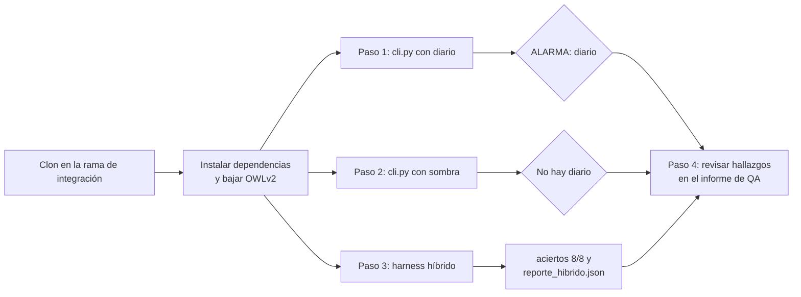
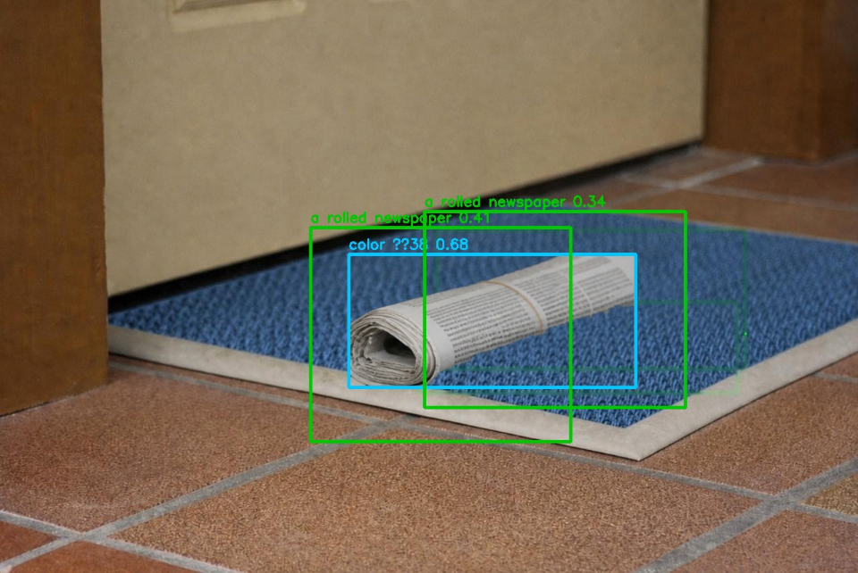
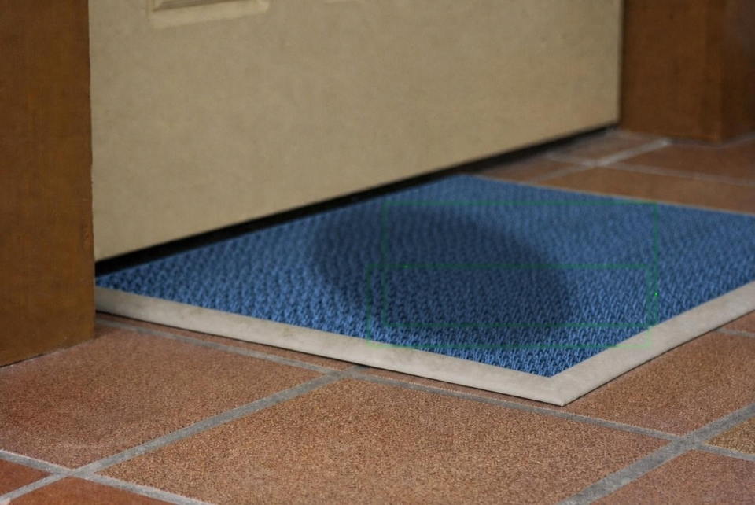

# RF-01 — Validación de la detección automática del diario

Guía de pruebas de integración de la Tarea **"Validacion de la detección automática del
diario"** (HU-01 Deteccion automatica del diario), para que cualquiera la repita sin
preguntar nada. Responsable de QA: Juan.

> En el proyecto hay varias Tareas con el código `RF-01`. Esta es la de la HU-01 cuyo
> nombre empieza con "Validacion".

- 🌐 **Dónde se prueba:** en local, sobre un clon del repositorio en la rama de
  integración. El proyecto todavía no tiene entornos cargados.
- 📄 **Informe de QA completo** (11 casos por 4 sistemas, recortes reales, regresión):
  [RF-01-informe-QA.pdf](RF-01-informe-QA.pdf)

## Qué se prueba

| Test (etapa integración) | Condición de aprobación |
|---|---|
| 1 | El sistema procesa una imagen de prueba y muestra el resultado de la detección. |
| 2 | Se registra el resultado de cada caso probado. |
| 3 | Se documentan los falsos positivos, falsos negativos y errores encontrados, si los hay. |
| 4 | Las pruebas pueden repetirse siguiendo instrucciones documentadas. |



## Preparación (una sola vez)

Desde la raíz del repositorio, con Python 3.11 o 3.12:

```bash
python -m venv .venv
source .venv/bin/activate
pip install -r hibrido/requirements.txt
python hibrido/descargar_modelo.py
```

`descargar_modelo.py` baja OWLv2 (~620 MB) a `hibrido/modelos/` y tiene que terminar con
`[OK] OWLv2 guardado en ...` (o `[OK] OWLv2 ya está en ...` si ya estaba).

**No toques `hibrido/config.json`**: las pruebas usan los valores por defecto del
repositorio (motor `owlv2`, resolución 320, umbral 0.30, prompts del diario).

## Datos de prueba

En [`datos/`](datos/), tres fotos de la misma cámara:

| Archivo | Qué es |
|---|---|
| `alfombra_vacia.jpg` | La alfombra de la entrada, sin nada. Es la referencia. |
| `alfombra_con_diario.jpg` | La misma, con un diario. **Semi-sintética**: el diario es real, pegado sobre la foto real de la alfombra. |
| `alfombra_con_sombra.jpg` | La misma, con una sombra encima. No tiene que dar alarma. |

## Paso 1 — Procesa una imagen con diario y muestra el resultado

```bash
python hibrido/cli.py --fondo docs/pruebas/hu-01-deteccion-automatica-del-diario/datos/alfombra_vacia.jpg --actual docs/pruebas/hu-01-deteccion-automatica-del-diario/datos/alfombra_con_diario.jpg
```

**Tiene que verse**, al final de la salida:

```
--- 3. Veredicto (modo cascada) ---
  color  dice: hay algo nuevo
  modelo dice: DIARIO
  ...
✅ ALARMA: diario

Imagen marcada: .../hibrido/capturas/hibrido_alfombra_con_diario.jpg
```

y en la sección `--- 2. OWLv2 ---`, `mejor confianza` mayor a `0.30` (medido: `0.408`).
La imagen marcada muestra el diario con un recuadro cian (lo que vio el color) y uno verde
(lo que reconoció el modelo):



## Paso 2 — Procesa una imagen sin diario y no da alarma

```bash
python hibrido/cli.py --fondo docs/pruebas/hu-01-deteccion-automatica-del-diario/datos/alfombra_vacia.jpg --actual docs/pruebas/hu-01-deteccion-automatica-del-diario/datos/alfombra_con_sombra.jpg
```

**Tiene que verse**:

```
--- 2. Modelo — salteado: el color no vio nada (modo cascada) ---
...
  razón:       el color no ve nada nuevo en la zona

❌ No hay diario
```

La imagen marcada sale sin recuadros: la sombra no se confunde con un objeto.



## Paso 3 — Se registra el resultado de cada caso

```bash
python harness/run_eval_hibrido.py
```

**Tiene que verse**, al final:

```
aciertos 8/8   VP=3 VN=5 FP=0 FN=0
precisión 1.00   recall 1.00
```

y `harness/reporte_hibrido.json` tiene que quedar con **8 filas** en `detalles`, una por
caso, cada una con `caso`, `esperado`, `obtenido` y `resultado` (`OK`, `FALSO POSITIVO` o
`FALSO NEGATIVO`).

## Paso 4 — Están documentados los falsos positivos, falsos negativos y errores

Abrir [RF-01-informe-QA.pdf](RF-01-informe-QA.pdf), sección **"4. Hallazgos"**. Tiene que
haber, por sistema probado, los falsos positivos y negativos con el caso que los produjo, y
los errores encontrados con su corrección. Medido en el informe:

| Sistema | Correctos | Falsas alarmas | No avisó |
|---|---|---|---|
| OpenCV original (`detect_diario.py`) | 5/11 | 6 | 0 |
| Híbrido + OWLv2 (el que se usa) | 11/11 | 0 | 0 |
| Híbrido + YOLO-World | 9/11 | 1 | 1 |

La condición 4 ("las pruebas pueden repetirse") se cumple si quien sigue esta guía sin
haber participado obtiene lo mismo en los pasos 1 a 3.

## Qué no cubre esta guía

- **La cámara en vivo** (`python hibrido/server.py`): necesita una cámara y permisos del
  sistema operativo, y no se puede repetir igual dos veces. Se probó a mano y está en el
  informe de QA.
- **Fotos reales de un diario en la entrada**: el caso con diario es semi-sintético. Si se
  consiguen pares reales (vacía y con diario, misma cámara), se agregan como carpetas en
  `data/pares/` y el harness los evalúa solo.
