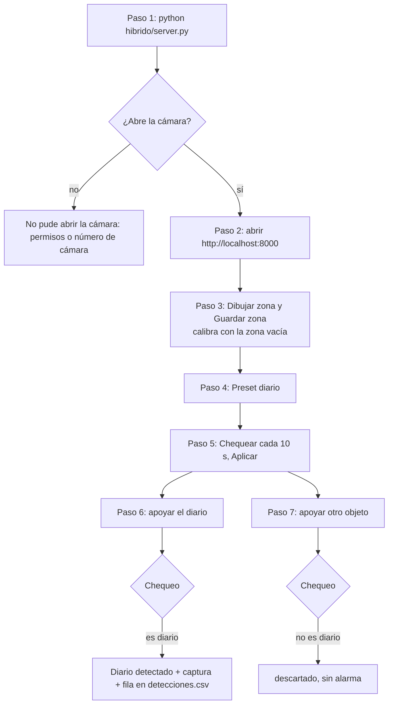

# RF-02 — Integración y verificación del detector híbrido

Guía de pruebas de integración de la Tarea **"Integracion y verificación del detector
hibrido"** (HU-01 Deteccion automatica del diario). Prueba el sistema completo andando:
servidor, cámara, página web y alarma. Responsable de QA: Juan.

- 🌐 **Probar en:** http://localhost:8000, con el servidor corriendo en la misma
  computadora que la cámara. El proyecto todavía no tiene entornos cargados.
- 📄 **Pruebas con imágenes fijas de la misma historia:**
  [RF-01-validacion-deteccion.md](RF-01-validacion-deteccion.md) ·
  **Informe de QA:** [RF-01-informe-QA.pdf](RF-01-informe-QA.pdf)

## Qué se prueba

| Test (etapa integración) | Condición de aprobación |
|---|---|
| 1 | El servidor inicia correctamente. |
| 2 | El detector procesa imágenes y muestra el resultado del chequeo. |
| 3 | Se documentan los errores encontrados y las pruebas realizadas. |



## Preparación (una sola vez)

La misma de [RF-01-validacion-deteccion.md](RF-01-validacion-deteccion.md#preparación-una-sola-vez):
instalar dependencias y bajar OWLv2. Además:

- **Una cámara conectada a la computadora** (la integrada, una USB o el iPhone como cámara
  de continuidad), apuntando fija a la zona a vigilar.
- **Permiso de cámara** para la aplicación de terminal desde donde se arranca el servidor
  (en macOS: Ajustes del Sistema › Privacidad y seguridad › Cámara).
- **Un diario** y **otro objeto que no sea un diario** (un celular, unos anteojos).
- `hibrido/config.json` sin modificar.

## Paso 1 — El servidor inicia

```bash
python hibrido/server.py
```

Si la cámara no es la primera del sistema, agregar `--camara 1` (o `2`).

**Tiene que verse**, en este orden y sin mensajes de error en el medio:

```
  Abrí  ->  http://localhost:8000

[modelo] usando 2 hilos de CPU
[modelo] resolución de entrada: 320x320
[modelo] OWLv2 cargado en device=cpu
[modelo] Buscando: a rolled newspaper, a newspaper, a folded newspaper
[camara] 1280x720 en índice 0
```

(La cantidad de hilos y la resolución de la cámara dependen de la computadora.) El servidor
queda corriendo y no vuelve al prompt.

**Si en cambio aparece** `No pude abrir la cámara 0.`, el servidor se cierra: es un
problema de permisos o del número de cámara, no del detector. Se corrige y se repite.

<!-- CAPTURA PENDIENTE: la terminal con la salida del paso 1 -->

## Paso 2 — La página muestra el video

Abrir http://localhost:8000 en un navegador.

**Tiene que verse** el título `Alarma de Diario` y el video de la cámara en vivo. El texto
`Esperando cámara…` desaparece cuando llega el primer cuadro.

<!-- CAPTURA PENDIENTE: la página con el video en vivo -->

## Paso 3 — Marcar la zona y calibrar

1. En el panel `Zona a vigilar`, apretar `Dibujar zona`.
2. Hacer clic en las 4 esquinas de la zona (la alfombra, o la hoja) sobre el video.
3. Apretar `Guardar zona`.
4. Dejar la zona vacía y sin manos unos segundos.

**Tiene que verse** el mensaje `Zona guardada. Recalibrando con la zona vacía…`, el contorno
de la zona dibujado en azul sobre el video, y el estado pasar de `calibrando` a `vigilando`.

<!-- CAPTURA PENDIENTE: botón "Dibujar zona" resaltado (scrum-qa-foco) -->
<!-- CAPTURA PENDIENTE: botón "Guardar zona" resaltado, con las 4 esquinas marcadas -->

## Paso 4 — Elegir qué buscar

En el panel `Qué busca el modelo`, apretar `Preset diario`.

**Tiene que verse**, debajo de los botones, `Buscando: a rolled newspaper, a newspaper, a
folded newspaper. Chequeando ya…`.

<!-- CAPTURA PENDIENTE: botón "Preset diario" resaltado -->

## Paso 5 — Chequear cada 10 segundos

En el panel `Frecuencia de chequeo`, mover `Chequear cada` hasta `10 s` y apretar `Aplicar`.

**Tiene que verse** `Chequeando cada 10 s. El primero arranca ya.`, y en `Próximo chequeo`
una cuenta regresiva (`en 10 s`, `en 9 s`…).

<!-- CAPTURA PENDIENTE: botón "Aplicar" de "Frecuencia de chequeo" resaltado -->

## Paso 6 — Con el diario, suena la alarma

Apoyar el diario dentro de la zona y retirar la mano.

**Tiene que verse**, en el chequeo siguiente (unos 15 s como máximo):

- el aviso rojo `Diario detectado — <hora>` arriba del video, con sonido;
- el estado `¡diario!`;
- en `Los dos validadores`, la tarjeta `2 · OWLv2 · ¿es diario?` con el voto `SÍ`;
- un recuadro verde sobre el diario en el video.

Y en la terminal, `[ALARMA] diario detectado — color y modelo coinciden: es diario (...)`.
Queda guardada una imagen `diario_<fecha>_<hora>.jpg` en `hibrido/capturas/`, y una fila
nueva en `hibrido/capturas/detecciones.csv` con estado `diario`.

<!-- CAPTURA PENDIENTE: la página con el aviso "Diario detectado" -->

## Paso 7 — Con otro objeto, no suena

Apretar `Silenciar`, sacar el diario, esperar un chequeo (vuelve a `vigilando`), y apoyar
el otro objeto.

**Tiene que verse**, en el chequeo siguiente, el estado `descartado` y en la tarjeta
`2 · OWLv2 · ¿es diario?` el voto `no`. **No** aparece el aviso rojo ni suena nada.

<!-- CAPTURA PENDIENTE: la página con el estado "descartado" y el otro objeto en la zona -->

## Paso 8 — Errores y pruebas documentados

- [RF-01-informe-QA.pdf](RF-01-informe-QA.pdf), sección **"4. Hallazgos"**: los errores
  encontrados en el QA (con su corrección) y las pruebas realizadas.
- [`hibrido/README.md`](../../../hibrido/README.md): cómo se instala y corre, qué hace
  cada etapa, y las secciones **"Cuando cambia la escena"** y **"Límite conocido"**.
- Esta guía y la de RF-01: las pruebas, con lo que tiene que verse en cada paso.

## Qué no cubre esta guía

- **Cámaras IP** (por red, `rtsp://` o `http://`): el servidor abre la cámara por número
  de dispositivo y no está documentado ni probado con cámaras IP.
- **Distinguir objetos muy parecidos**: buscando un lápiz, una birome negra puede dar
  alarma (está en el informe de QA, como límite conocido).
